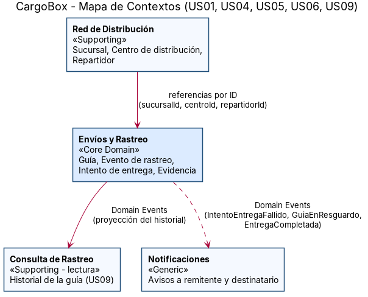
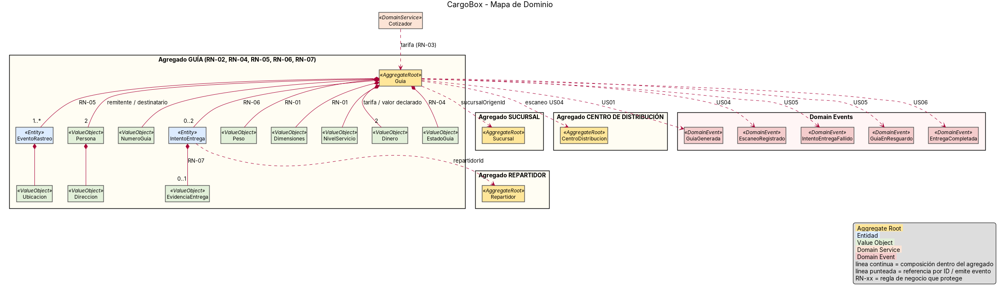
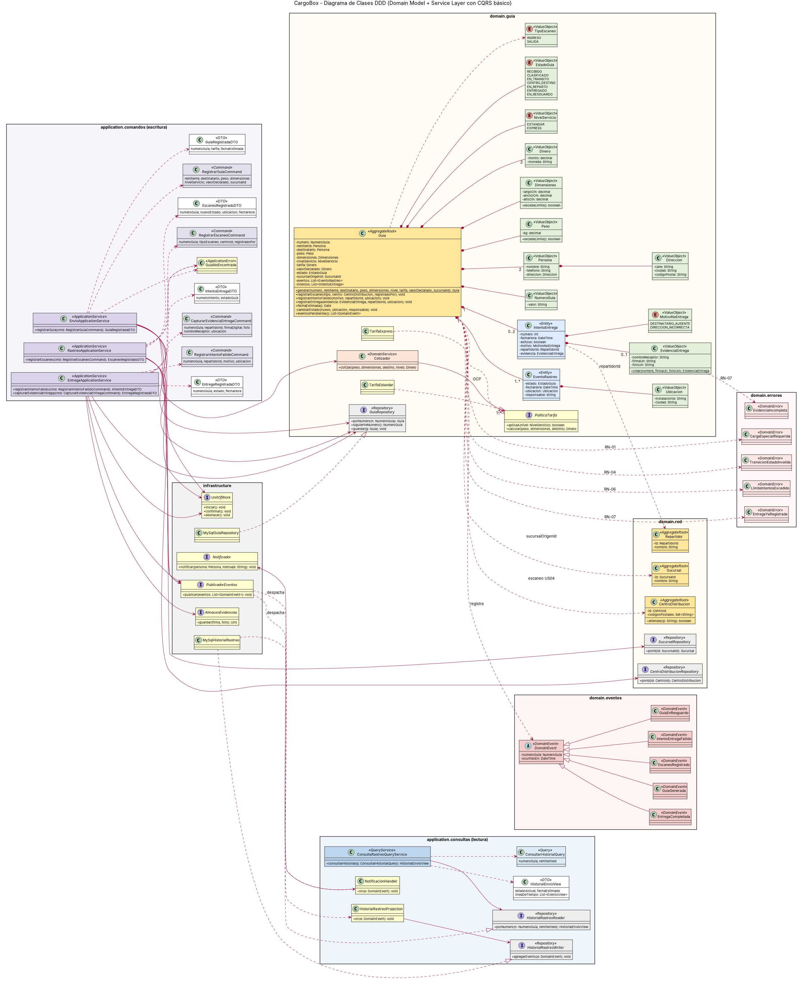
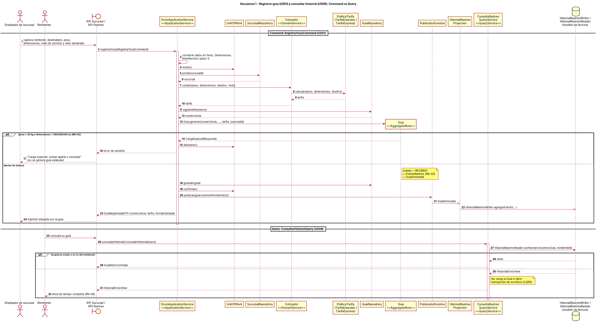
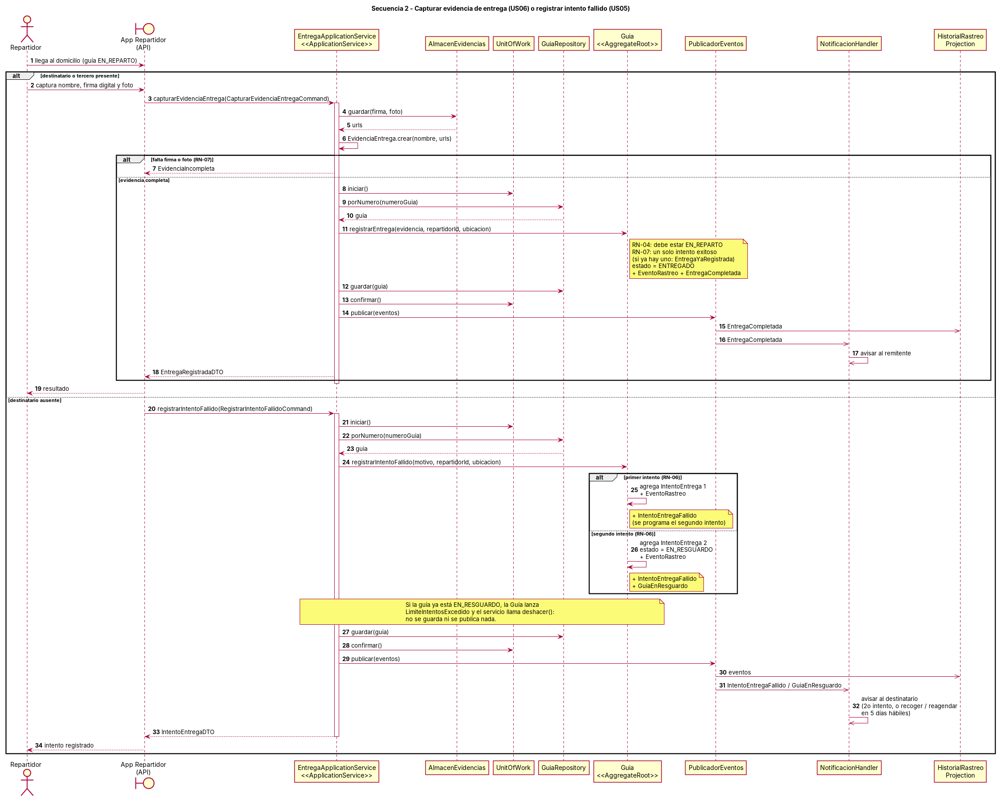

# CargoBox (Caso 14) — U3 Diseño Arquitectural del Sistema

**Curso:** Componentes de Lógica de Negocio · FIME UANL

Diseño de la lógica de negocio de **CargoBox** (paquetería con envíos nacionales) con Domain-Driven Design, a partir de los entregables de la Unidad 2 (BRD, User Stories, BPMN, Modelo de dominio y glosario).

- **Historias de usuario base:** US01, US04, US05, US06 y US09.
- **Patrón elegido:** Domain Model para los comandos y consultas directas para lectura.
- **Service Layer:** cuatro Application Services con un método por caso de uso (EnvioApplicationService, RastreoApplicationService, EntregaApplicationService y ConsultaRastreoQueryService), con CQRS básico y revisada con los 5 principios SOLID.

El reporte completo, con las tablas comparativas, el mapa de dominio explicado, la Service Layer, la trazabilidad, la bitácora de IA y las conclusiones, está en [docs/Reporte_DiseñoArquitectural_E14.pdf](docs/Reporte_DiseñoArquitectural_E14.pdf).

## Entregables

| Entregable | Archivos |
|---|---|
| Diagramas DDD | [00-mapa-contextos](docs/diagramas/00-mapa-contextos.puml), [01-mapa-dominio](docs/diagramas/01-mapa-dominio.puml) |
| Diagrama de clases | [02-diagrama-clases](docs/diagramas/02-diagrama-clases.puml) |
| Diagramas de secuencia | [03-secuencia-registrar-guia](docs/diagramas/03-secuencia-registrar-guia.puml), [04-secuencia-entrega-intento-fallido](docs/diagramas/04-secuencia-entrega-intento-fallido.puml) |
| ADR | [docs/adr/](docs/adr/) |
| Matriz de trazabilidad y recorrido del BPMN | [docs/matriz-trazabilidad.md](docs/matriz-trazabilidad.md) |
| Bitácora de uso de IA | [docs/bitacora-ia.md](docs/bitacora-ia.md) |
| Reporte | [docs/reporte-U3-CargoBox.pdf](docs/reporte-U3-CargoBox.pdf) |

## Diagramas

### Mapa de contextos

### Mapa de dominio

### Diagrama de clases

### Secuencia 1 — registrarGuia (US01) y consultarHistorial (US09)

### Secuencia 2 — capturarEvidenciaEntrega (US06) o registrarIntentoFallido (US05)

Los archivos fuente están en PlantUML (`.puml`) y en Mermaid (`docs/diagramas/mermaid/*.mmd`, la versión que se puede importar en draw.io).

## ADR

- [ADR-001 — Domain Model para comandos y consultas directas para lectura](docs/adr/ADR-001.md)
- [ADR-002 — La Guía es la raíz del agregado y dueña de su historial de rastreo](docs/adr/ADR-002.md)
- [ADR-003 — CQRS básico: comandos y consulta separados](docs/adr/ADR-003.md)
- [ADR-004 — Domain Events para notificar y actualizar el historial](docs/adr/ADR-004.md)
- [ADR-005 — Service Layer delgada con cuatro Application Services por área del negocio](docs/adr/ADR-005.md)
